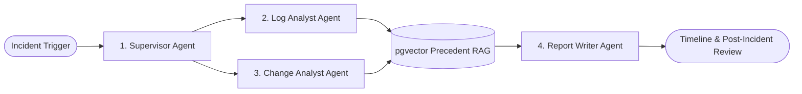

# IT-Ops Multi-Agent Incident Summariser

> **Autonomous multi-agent platform for enterprise IT-operations: log anomaly discovery, GitHub change correlation, pgvector semantic precedent retrieval, and Post-Incident Review (PIR) generation.**

Powered by **LangGraph**, **FastAPI**, **Google Gemini 3.8 Flash**, **PostgreSQL 16**, and **pgvector**.

---

## ⚡ Key Highlights

- **4 Specialized AI Agents**:
  - 🧠 **Supervisor Agent**: Plans investigation, enforces execution step budget (12 steps max), and routes tasks.
  - 🔍 **Log Analyst Agent**: Clusters HTTP 5xx errors & timeouts; separates observed facts from inferences.
  - 🔄 **Change Analyst Agent**: Analyzes recent git commits and deployments for temporal correlation.
  - 📝 **Report Writer Agent**: Generates verified chronological timelines, root-cause hypotheses, and Post-Incident Reviews.
- **pgvector Semantic Search**: Instant precedent retrieval from historical incidents via 768-dim vector embeddings.
- **Enterprise Web Dashboard**: Pure HTML, modern CSS, and Vanilla JavaScript with dark mode and live agent stepper.
- **100% Verified Test Suite**: 32/32 passing tests including an incident replay benchmark against human ground truth.
- **Deploy Anywhere**: Full Docker Compose, standalone Docker, and AWS EKS Kubernetes manifests included.

---

## 🏗️ Multi-Agent Architecture



---

## 🚀 Quick Start (Run Locally)

### Option 1: Docker Compose (Recommended - Full Stack)

Spins up the FastAPI app and PostgreSQL 16 with `pgvector` together:

```bash
# 1. Copy environment template (configured for Gemini 3.8 Flash)
cp .env.example .env

# 2. Build and start services in background
docker compose up --build -d

# 3. Run database migrations inside container
docker compose exec app alembic upgrade head

# 4. (Optional) Seed demo incidents & historical knowledge
docker compose exec app python scripts/seed_demo_data.py
```

- 🌐 **Dashboard UI**: [http://localhost:8000](http://localhost:8000)
- 📖 **API Docs (Swagger)**: [http://localhost:8000/docs](http://localhost:8000/docs)
- 🩺 **Health Endpoint**: [http://localhost:8000/health](http://localhost:8000/health)

To stop services:
```bash
docker compose down
```

---

### Option 2: Standalone Docker

```bash
# 1. Build Docker image
docker build -t itops-incident-summariser -f docker/Dockerfile .

# 2. Run container
docker run -d --name itops-app -p 8000:8000 --env-file .env itops-incident-summariser
```

---

### Option 3: Local Python

```bash
# 1. Install dependencies
pip install -r requirements.txt

# 2. Setup environment & run migrations
cp .env.example .env
alembic upgrade head

# 3. Start development server
uvicorn app.main:app --reload --port 8000
```

> **Offline Mode**: If `GEMINI_API_KEY` is not provided in `.env`, the system automatically runs with a deterministic offline mock.

---

## 📁 Project Structure

```
.
├── app/
│   ├── agents/          # Supervisor, Log Analyst, Change Analyst, Report Writer
│   ├── api/             # FastAPI REST endpoints & dependency injection
│   ├── database/        # SQLAlchemy 2.x models & repository layer
│   ├── graph/           # LangGraph workflow, nodes, and conditional edges
│   ├── integrations/    # GitHub client & log source adapters
│   ├── observability/   # OpenTelemetry & Langfuse tracing
│   ├── rag/             # pgvector similarity search & embeddings
│   ├── schemas/         # Pydantic data validation contracts
│   └── services/        # Gemini 3.8 Flash service & incident orchestration
├── frontend/            # Vanilla HTML5, CSS3, & JS Command Center
├── tests/               # 32 pytest tests & incident replay fixtures
├── docker/              # Multi-stage Dockerfile (non-root UID 1001)
├── k8s/                 # Kubernetes manifests (Deployment, Ingress, HPA, Jobs)
├── docs/                # Enterprise & deployment documentation
├── docker-compose.yml   # Multi-container local stack
├── requirements.txt     # Locked Python package versions
└── pytest.ini           # Pytest configuration
```

---

## 📡 API Reference

| Method | Endpoint | Description |
| :--- | :--- | :--- |
| `GET` | `/health` | Application health and version check |
| `GET` | `/api/v1/incidents` | List incidents with filters & pagination |
| `POST` | `/api/v1/incidents` | Declare a new incident |
| `GET` | `/api/v1/incidents/{id}` | Get incident details |
| `POST` | `/api/v1/incidents/{id}/investigate` | Trigger autonomous multi-agent investigation |
| `GET` | `/api/v1/incidents/{id}/investigation` | Get agent execution progress & step audit |
| `GET` | `/api/v1/incidents/{id}/timeline` | Retrieve verified chronological timeline |
| `GET` | `/api/v1/incidents/{id}/report` | Retrieve synthesized Post-Incident Review (PIR) |
| `POST` | `/api/v1/incidents/{id}/report/regenerate` | Force re-synthesis of incident report |

---

## 🧪 Testing

Run the full automated test suite:

```bash
pytest
```

All 32 tests execute offline using deterministic fixtures and mocks—no external databases, GitHub tokens, or API keys required.

---

## 📚 Enterprise & Production Documentation

- 📘 **[FDE Enterprise Blueprint (BRD, SRD, TRD, Playbook & ROI)](docs/FDE_SPECIFICATION_AND_PLAYBOOK.md)**: Full enterprise specification, architecture, field deployment playbook, and quantified financial ROI model.
- 🚀 **[AWS EKS Production Deployment Guide](docs/EKS_DEPLOYMENT_GUIDE.md)**: Step-by-step production deployment guide for Amazon EKS, Aurora PostgreSQL (pgvector), and AWS ALB.

---

## License

Apache-2.0
