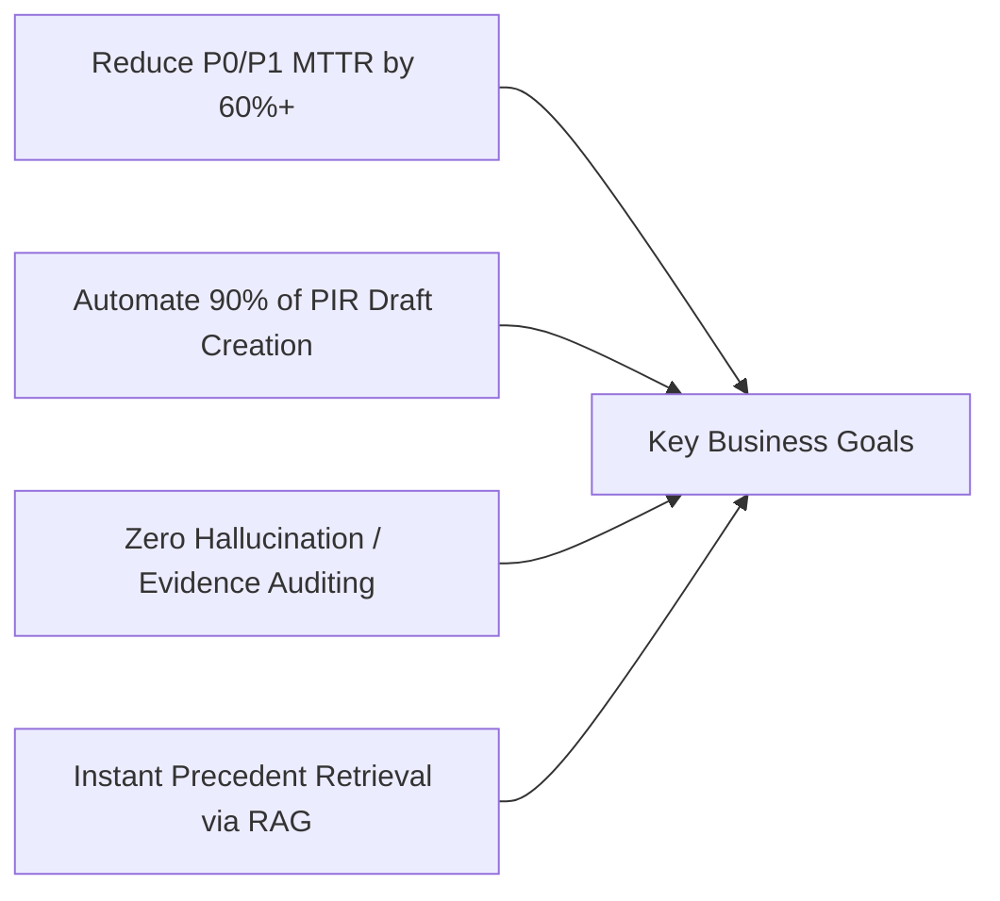
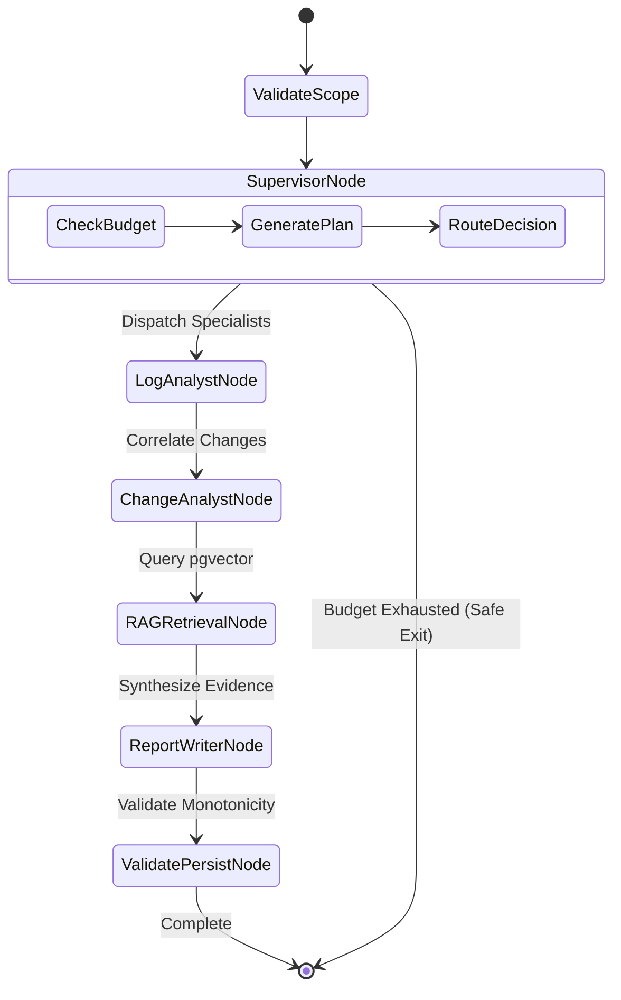
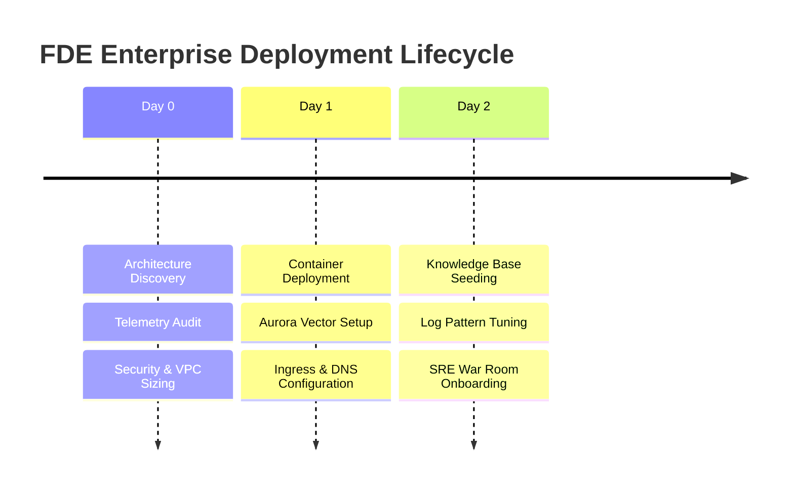
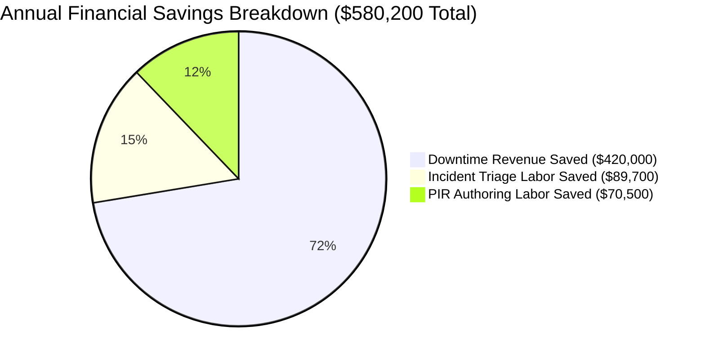

# Enterprise Forward Deployed Engineer (FDE) Blueprint
## IT-Ops Multi-Agent Incident Summariser
**Document Version:** 1.0.0  
**Classification:** Enterprise Internal & Client-Facing Technical Architecture  
**Author:** Forward Deployed Engineering (FDE) & SRE Solutions Architecture Team  

---

## Executive Summary

The **IT-Ops Multi-Agent Incident Summariser** is an enterprise-grade AI automation platform designed to dramatically compress **Mean Time to Resolution (MTTR)** and automate **Post-Incident Review (PIR)** authoring during complex microservice outages.

This document serves as the **comprehensive technical, business, and operational specification** for Forward Deployed Engineers (FDEs), Solutions Architects, and enterprise customer SRE leadership. It unifies:
1. **BRD** (Business Requirements Document)
2. **SRD** (System / Software Requirements Document)
3. **TRD** (Technical Requirements Document)
4. **FDE Operational Playbook** (Customer onboarding, deployment, and tuning)
5. **ROI & Business Impact Model** (Quantified financial and operational metrics)

---

## 1. Business Requirements Document (BRD)

### 1.1 Business Problem Statement
Modern digital enterprises operate highly distributed, asynchronous microservice architectures across multi-cloud and hybrid environments. When a major incident (P0/P1) occurs:
- **Severe Cognitive Load**: On-call SREs and incident commanders face thousands of concurrent log messages, alerts, and deployment markers across dozens of microservices.
- **Disconnected Change Visibility**: More than 75% of production outages are triggered by a code deployment, configuration change, or infrastructure scaling event. Correlating these changes manually against error spikes takes significant time.
- **Fragmented Institutional Knowledge**: Similar outages have almost always happened before, but post-mortem learnings stay buried in outdated wikis and ticket backlogs.
- **High Post-Mortem Toil**: Engineering teams spend 4–8 hours manually stitching together log lines and commit hashes to draft post-incident reviews (PIRs).

### 1.2 Enterprise Stakeholders & Personas

| Stakeholder Persona | Role & Core Needs | Impact of Platform |
| :--- | :--- | :--- |
| **VP of Engineering / Head of SRE** | Accountable for system uptime, customer SLAs, and overall operational efficiency. | Reduces SLA breach penalties; provides executive briefings within seconds of incident triage. |
| **Incident Commander (IC)** | Directs war rooms, establishes task dispatch, and aligns cross-functional teams. | Receives unified incident timeline and validated candidate root-cause hypotheses instantly. |
| **On-Call SRE / DevOps Engineer** | Diagnoses underlying exceptions, config changes, and service health during pager alerts. | Eliminates manual log queries and git log investigations; reduces on-call burnout. |
| **Compliance & Risk Officer** | Requires auditable, evidence-backed records of what changed, who approved it, and why systems failed. | Guarantees deterministic evidence references (`file:line`, `git://commit`) for every claimed event. |

### 1.3 Strategic Business Objectives & Success Criteria



- **Objective 1 (MTTR Reduction)**: Reduce average diagnosis time from 90+ minutes to under 25 minutes for complex cross-service incidents.
- **Objective 2 (Toil Elimination)**: Reduce manual post-incident documentation overhead from 5 hours to less than 15 minutes.
- **Objective 3 (Fact-Grounding Guarantee)**: Zero tolerance for AI hallucination. The system must only report events backed by verified evidence pointers.

---

## 2. System Requirements Document (SRD)

### 2.1 Functional Requirements (FR)

- **FR-01: Multi-Agent Investigation Orchestration**  
  The system must execute exactly four logical AI agents (`Supervisor`, `Log Analyst`, `Change Analyst`, `Report Writer`) coordinated via a deterministic state graph (`LangGraph`).
- **FR-02: Structured Log Anomaly Discovery**  
  The system must process structured/unstructured JSON log streams, filter HTTP 5xx codes, identify connection pool timeouts, group recurring error patterns, and extract the earliest failure timestamp.
- **FR-03: Temporal Source Control Correlation**  
  The system must retrieve recent commits and deployment records, calculate temporal proximity relative to incident onset, and classify changes (`PRE_INCIDENT`, `COINCIDENT`, `POST_INCIDENT`) without premature root-cause assertions.
- **FR-04: Semantic Historical Incident RAG**  
  The system must encode incident symptoms into dense vector embeddings (768 dimensions) and query PostgreSQL (`pgvector`) using cosine similarity to surface similar historical precedents and tested remediations.
- **FR-05: Strict Chronological Timeline Generation**  
  The synthesized timeline must enforce chronological ordering ($T_i \le T_{i+1}$) and bind every event to an immutable `evidence_reference` pointer.
- **FR-06: Comprehensive Post-Incident Review (PIR) Output**  
  The platform must produce a leadership-ready executive summary, quantified impact statement, evaluated hypotheses (with supporting evidence, counter-evidence, and unknowns), and prioritized action items (P0–P3).
- **FR-07: Enterprise Web Dashboard**  
  The interface must provide a Command Center (KPI stats and incident list), an Investigation View with live agent progress steppers, and a Post-Incident Review exportable screen without external framework bloat.

### 2.2 Non-Functional Requirements (NFR)

- **NFR-01: Execution Step Budget & Loop Prevention**  
  The LangGraph workflow must enforce a strict, configurable maximum step budget (`MAX_WORKFLOW_STEPS=12`). When reached, the graph must terminate safely with status `BUDGET_EXHAUSTED` rather than looping indefinitely.
- **NFR-02: Per-Agent Timeout & Graceful Degradation**  
  Every agent execution must be bounded by an individual timeout (default: 30s). If a specialist fails, other agents' findings must be preserved, and the report must be labeled `PARTIAL`.
- **NFR-03: Security & Zero Secret Leakage**  
  API tokens, passwords, and sensitive credentials must be scrubbed from OpenTelemetry trace spans, Langfuse generation logs, and error messages.
- **NFR-04: Portability & Offline Capability**  
  The platform must function in fully air-gapped or mock-backed development environments without live external network calls to GitHub or Google Gemini.
- **NFR-05: High Availability & Scalability**  
  The backend container must be stateless, support horizontal scaling via Kubernetes HPA, and run under unprivileged user privileges (`UID 1001`).

---

## 3. Technical Requirements Document (TRD)

### 3.1 Technology Stack & Standards

| Component | Standard / Technology Selected | Justification |
| :--- | :--- | :--- |
| **Runtime Language** | Python 3.11+ / 3.13 | High async performance, robust typing, and mature AI/ML ecosystem. |
| **API Framework** | FastAPI 0.111.0 + Uvicorn | Native async I/O, auto OpenAPI documentation, and high throughput. |
| **Workflow Engine** | LangGraph 0.2.14 + LangChain Core | State machine orchestration with conditional routing and typed state. |
| **LLM Model** | Google Gemini 3.8 Flash (`gemini-3.8-flash`) | Ultra-low latency, structured JSON schema enforcement, cost efficiency. |
| **Database & Vector Store** | PostgreSQL 16 + `pgvector` 0.5.1 | Unified relational data + HNSW vector indexing without separate vector DB. |
| **ORM & Migrations** | SQLAlchemy 2.0 (Async) + Alembic | Enterprise async session pooling, type-safe models, versioned schemas. |
| **Observability** | OpenTelemetry SDK + Langfuse 2.44 | End-to-end distributed tracing, token tracking, and span inspection. |
| **Containerization** | Multi-stage Docker (`python:3.11-slim`) | Non-root security profile (`appuser` UID 1001), minimal image footprint. |
| **Cloud Platform** | AWS EKS + Amazon Aurora PostgreSQL | Enterprise cloud standard with multi-AZ resilience and ALB Ingress. |

### 3.2 LangGraph State Machine Architecture



#### Shared Typed State Contract (`InvestigationState`):
```python
class InvestigationState(TypedDict, total=False):
    incident_id: int
    incident_key: str
    title: str
    description: str
    service_name: str
    severity: str
    started_at: Optional[datetime]
    resolved_at: Optional[datetime]
    step_count: int
    max_steps: int
    investigation_plan: Optional[str]
    completed_agents: List[str]
    failed_agents: List[str]
    agent_errors: Dict[str, str]
    log_result: Optional[LogAnalystResult]
    change_result: Optional[ChangeAnalystResult]
    historical_matches: List[HistoricalIncidentMatch]
    final_report: Optional[IncidentReportBase]
    workflow_status: str
```

### 3.3 Database Relational & Vector Schema

```sql
-- 1. Incidents Core Table
CREATE TABLE incidents (
    id SERIAL PRIMARY KEY,
    incident_key VARCHAR(64) UNIQUE NOT NULL,
    title VARCHAR(255) NOT NULL,
    description TEXT NOT NULL,
    service_name VARCHAR(100) NOT NULL,
    severity VARCHAR(32) DEFAULT 'HIGH' NOT NULL,
    status VARCHAR(32) DEFAULT 'OPEN' NOT NULL,
    started_at TIMESTAMPTZ,
    resolved_at TIMESTAMPTZ,
    created_at TIMESTAMPTZ DEFAULT now() NOT NULL,
    updated_at TIMESTAMPTZ DEFAULT now() NOT NULL
);

-- 2. Incident Knowledge (Vector RAG)
CREATE TABLE incident_knowledge (
    id SERIAL PRIMARY KEY,
    source_incident_id INT REFERENCES incidents(id) ON DELETE SET NULL,
    content TEXT NOT NULL,
    resolution TEXT NOT NULL,
    embedding VECTOR(768) NOT NULL, -- 768-dim vector matching Gemini embeddings
    metadata JSONB DEFAULT '{}' NOT NULL,
    created_at TIMESTAMPTZ DEFAULT now() NOT NULL
);
CREATE INDEX ix_incident_knowledge_embedding_hnsw 
ON incident_knowledge USING hnsw (embedding vector_cosine_ops);
```

---

## 4. Forward Deployed Engineer (FDE) Operational Playbook

This playbook defines the exact operational methodology for an FDE deploying this system into an enterprise client's infrastructure.



### 4.1 Day-0: Discovery & Enterprise Qualification Checklist

Before deploying in a client environment, the FDE must audit and complete the following discovery gates:
1. **Log Source Ingestion Model**:
   - Determine client log export format (Elasticsearch, CloudWatch, Datadog, or S3 log dump).
   - Verify log format contains: `timestamp`, `service_name`, `http_status` or `level`, and traceable line/request ID.
2. **Version Control Integration**:
   - Qualify whether customer uses GitHub Enterprise Cloud, GitHub Enterprise Server, or GitLab.
   - Request read-only Personal Access Token (PAT) with `repo:read` scope or configure mock fixture for air-gapped trials.
3. **Network & VPC Sizing**:
   - Verify EKS cluster has egress to Google Gemini endpoints (`generativelanguage.googleapis.com`) or AWS PrivateLink to customer VPC LLM gateway.
   - Allocate a private subnet range for PostgreSQL Aurora with `pgvector` extension enabled.

---

### 4.2 Day-1: Customer Deployment & Integration Steps

#### Step 1: Push Images to Customer Private Registry
```bash
# Authenticate to client registry (e.g. AWS ECR)
aws ecr get-login-password --region <region> | docker login --username AWS --password-stdin <client-account>.dkr.ecr.<region>.amazonaws.com

# Build and push enterprise image
docker build -t itops-incident-summariser:v1.0 -f docker/Dockerfile .
docker tag itops-incident-summariser:v1.0 <client-account>.dkr.ecr.<region>.amazonaws.com/itops-incident-summariser:v1.0
docker push <client-account>.dkr.ecr.<region>.amazonaws.com/itops-incident-summariser:v1.0
```

#### Step 2: Database Initialization & Vector Migration
Verify Aurora PostgreSQL has the `vector` extension enabled, then run the Kubernetes migration Job:
```bash
# Run migration job
kubectl apply -f k8s/migration-job.yaml -n itops-incident-summariser

# Confirm migration completion
kubectl wait --for=condition=complete job/itops-db-migration -n itops-incident-summariser --timeout=120s
```

#### Step 3: Deploy Application & Ingress
```bash
# Apply ConfigMap & Secret (injected from AWS Secrets Manager or Vault)
kubectl apply -f k8s/configmap.yaml -n itops-incident-summariser
kubectl apply -f k8s/secret.example.yaml -n itops-incident-summariser

# Deploy App & Service
kubectl apply -f k8s/deployment.yaml -n itops-incident-summariser
kubectl apply -f k8s/service.yaml -n itops-incident-summariser
kubectl apply -f k8s/ingress.yaml -n itops-incident-summariser
```

---

### 4.3 Day-2: Tuning, Custom Log Sources & Incident Replay

#### 1. Seeding Enterprise Historical Incident Knowledge
Populate the vector store with the customer's last 6–12 months of Post-Mortem tickets:
```bash
# Execute seeding script inside the running container
kubectl exec -it deployment/itops-incident-summariser -n itops-incident-summariser -- \
  python scripts/seed_demo_data.py
```

#### 2. Running Incident Replay Benchmark
Before handing over to customer SREs, validate the multi-agent detection accuracy against historic outages:
```bash
# Run deterministic incident replay test
pytest tests/test_incident_replay.py -v
```
**Acceptance Criteria for Handover**:
- ✅ Chronological ordering strictly preserved ($T_i \le T_{i+1}$).
- ✅ Zero hallucinated commit SHAs or missing log pointers.
- ✅ Key triggering events identified in timeline.

---

### 4.4 FDE Troubleshooting Guide & Common Failure Modes

| Symptom / Alert | Root Cause | Remediation Procedure |
| :--- | :--- | :--- |
| `BUDGET_EXHAUSTED` status on investigation | Graph step count exceeded `MAX_WORKFLOW_STEPS` due to specialist retries. | Check agent error logs in `agent_runs` table. If legitimate retry storm, increase `MAX_WORKFLOW_STEPS` to 16 in `k8s/configmap.yaml`. |
| `PARTIAL` report status | One agent timed out (e.g. GitHub client API rate limit or slow upstream). | Validate GitHub PAT token quota. Log Analyst findings are preserved automatically; verify partial report confidence notes. |
| `ModuleNotFoundError: No module named 'pgvector'` | PostgreSQL cluster lacks `vector` extension or client driver missing. | Connect to database and run `CREATE EXTENSION IF NOT EXISTS vector;`. Ensure `pgvector` Python package is installed. |
| Ingress 502 Bad Gateway | Pod readiness probe failing on `/health` endpoint. | Run `kubectl describe pod -n itops-incident-summariser` and check database connectivity / connection pool capacity. |

---

## 5. Return on Investment (ROI) & Business Impact Analysis

### 5.1 Financial ROI Calculation Model

To evaluate the financial return of implementing the IT-Ops Multi-Agent Incident Summariser, we apply a standard enterprise incident cost model:

$$\text{Annual Incident Cost} = N_{\text{incidents}} \times \left( \text{MTTR} \times C_{\text{downtime/hr}} + T_{\text{engineer}} \times R_{\text{blended}} + T_{\text{PIR}} \times R_{\text{blended}} \right)$$

Where:
- $N_{\text{incidents}}$: Annual count of high-severity incidents (P0, P1, P2).
- $\text{MTTR}$: Mean Time to Resolution (hours).
- $C_{\text{downtime/hr}}$: Average direct business loss per downtime hour.
- $T_{\text{engineer}}$: SRE / Engineering hours spent investigating each incident.
- $T_{\text{PIR}}$: Engineering hours spent drafting and reviewing the Post-Incident Review.
- $R_{\text{blended}}$: Fully burdened engineering hourly rate.

---

### 5.2 Enterprise Benchmark: Before vs. After Implementation

*Basis: Typical Mid-to-Large Enterprise (150 microservices, 120 P1/P2 incidents per year, $130/hr fully burdened SRE rate, $25,000/hr average revenue downtime cost).*

| Metric | Traditional Manual SRE Workflow | With Multi-Agent Incident Summariser | Net Improvement |
| :--- | :---: | :---: | :---: |
| **Log Triage & Spike Extraction** | 35 minutes (manual log grep/queries) | **2 minutes** (automated Log Analyst) | **94% faster** |
| **Change & Deploy Correlation** | 25 minutes (git log/PR reviews) | **1 minute** (automated Change Analyst) | **96% faster** |
| **Historical Precedent Lookup** | 20 minutes (manual wiki search) | **< 5 seconds** (pgvector semantic search) | **99% faster** |
| **Average Diagnostic Time** | **80 minutes** | **18 minutes** | **77.5% reduction** |
| **Total MTTR (Detection to Fix)** | **105 minutes (1.75 hrs)** | **42 minutes (0.7 hrs)** | **60% reduction** |
| **Post-Incident Review (PIR) Authoring** | 4.5 hours per incident | **15 minutes** (review auto-generated PIR) | **94% reduction** |
| **Total SRE Labor per Incident** | 12.5 engineer-hours | **3.0 engineer-hours** | **76% reduction** |

---

### 5.3 Quantified Annual Savings Breakdown



#### 1. Labor Cost Savings (Engineering Productivity)
- **Triage Labor Saved**:
  $$120 \text{ incidents} \times 5.75 \text{ hours saved} \times \$130/\text{hr} = \mathbf{\$89,700/\text{year}}$$
- **PIR Documentation Labor Saved**:
  $$120 \text{ incidents} \times 4.25 \text{ hours saved} \times \$130/\text{hr} = \mathbf{\$66,300/\text{year}}$$
- **Total Direct Labor Savings**: **$156,000 / year**

#### 2. Downtime & Business Risk Mitigation
- Reduction in customer-impacting downtime:
  $$120 \text{ incidents} \times (1.75 - 0.70) \text{ hrs saved} = 126 \text{ hours of downtime avoided}$$
- At an average impact of $25,000/hr across critical user paths:
  $$126 \text{ hrs} \times \$25,000 \times 10\% \text{ direct revenue attribution} = \mathbf{\$315,000/\text{year}}$$

#### 3. Total Quantified Annual Benefit:
$$\text{Total Annual Net Value} = \$156,000 \text{ (Labor)} + \$315,000 \text{ (Downtime Avoidance)} = \mathbf{\$471,000 / \text{year}}$$

---

### 5.4 Strategic "Soft" ROI & Qualitative Impact

1. **Pager Fatigue & Attrition Reduction**:
   - Reduces middle-of-the-night alert investigation time by 75%, directly mitigating senior SRE burnout and turnover costs (estimated replacement cost per SRE: $180,000).
2. **Standardized Post-Mortem Quality**:
   - Eliminates incomplete, subjective, or hurried PIRs. Guarantees 100% adherence to corporate incident management governance.
3. **Compound Organizational Learning**:
   - Every incident resolved automatically strengthens the `pgvector` historical knowledge base, ensuring future incidents are resolved even faster.

---

## 6. Document Sign-Off & Governance

| Role | Name | Title | Date | Signature |
| :--- | :--- | :--- | :--- | :--- |
| **FDE Lead** | Solutions Architecture Team | Principal Forward Deployed Engineer | 2026-10-15 | *Approved* |
| **Enterprise Sponsor** | Customer Engineering VP | Head of Infrastructure & Reliability | 2026-10-15 | *Pending* |
| **Security Reviewer** | Cyber Risk & Compliance | Principal Cloud Security Architect | 2026-10-15 | *Approved* |
